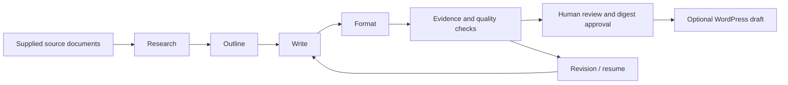

# AI Content Automation Pipeline

> Private staging: source and offline/API checks are complete. Actions upload, remote CI, and public release are pending workflow authorization. See [verification](docs/verification.json).

A Python workflow that turns supplied source documents into a reviewed technical article through four AI stages. It preserves evidence, resumes interrupted work, bounds managed AI reservations, and delivers **drafts only** after human approval.

**Try it without API keys, network access, WordPress, or paid AI calls.** The default provider uses labeled fixture responses through the same runner and validators as live providers.



## Quickstart

Python 3.11 or 3.12:

```sh
git clone https://github.com/somthompsonvill/ai-content-automation-pipeline.git
cd ai-content-automation-pipeline
python -m venv .venv
```

Activate with `.venv\Scripts\Activate.ps1` in PowerShell, or `source .venv/bin/activate` on macOS/Linux. Then:

```sh
python -m pip install .
python -m automation_pipeline demo
```

The command prints a run ID and review digest. Open `runs/<run-id>/preview.html`; the draft, quality report, evidence ledger, requests, and responses are retained locally. Repeating `demo` creates a separate run. Its example sources are project-authored demonstration material hosted at illustrative `example.com` URLs; no web retrieval or independent verification is implied.

For a reproducible failure → revision → approval walkthrough:

```sh
python scripts/demo_walkthrough.py
```

This starts with an intentionally unresolved evidence marker, verifies that approval is blocked, revises the draft, and records a local human acknowledgment. See [example output](docs/example-output.md).

## What it demonstrates

- Schema-validated research, outline, draft, and metadata stages.
- Exact source-excerpt checks, claim references, and transparent evidence limitations.
- Immutable revisions, input fingerprints, checkpoint reuse, and explicit recovery after uncertain requests.
- Local SQLite or GitHub SHA-conditional USD reservations before paid attempts.
- GitHub IssueOps with permission checks, issue-to-run bindings, digest approvals, and comment deduplication.
- Standard WordPress REST delivery with draft-only status, readback, external-edit detection, and uncertain-create reconciliation.
- Offline tests, Windows/Linux CI, isolated wheel checks, and a free demonstration workflow.

## Commands

```sh
python -m automation_pipeline run --config examples/technical-guide/config.json
python -m automation_pipeline review --run-id <id>
python -m automation_pipeline resume --run-id <id>
python -m automation_pipeline revise --run-id <id> --feedback-file feedback.md
python -m automation_pipeline approve --run-id <id> --digest <digest>
python -m automation_pipeline deliver --run-id <id> --target wordpress
```

The global `--output-dir <path>` option goes **before** the command when reviewing runs outside `./runs`. For `run`, output comes from its configuration file. Relative configuration paths resolve against that file. Normal generation blocks duplicate normalized topic/locale pairs; it does not promise semantic similarity detection.

Prompts live in the installed package's `assets/prompts` directory. Root `prompts/` mirrors them for browsing; change both copies together and run the resource consistency test.

## Optional integrations

[Setup and recovery guide](docs/integrations.md) · [Architecture](docs/architecture.md) · [Security boundaries](SECURITY.md) · [Release verification](docs/release-checklist.md)

Live providers require an optional dependency, explicit model and cost profile, credentials, and an initialized budget month. No current provider prices or paid allowance are assumed. The default demo requires none of them.

WordPress needs only standard posts REST endpoints and an application password for a separate test site. This project never publishes a post or installs a plugin. A reviewer publishes manually in WordPress.

## Development

```sh
python -m pip install -r requirements-dev.lock
python -m pip install --no-deps --no-build-isolation -e .
python -m pytest -q
python -m ruff check src tests scripts
python -m build --no-isolation
python scripts/wheel_smoke.py
```

Dependency versions are resolved across platforms. Refresh with `uv pip compile pyproject.toml --extra dev --extra all --universal -o requirements-dev.lock` and review the resulting changes.

## Limits and honest claims

GREEN means deterministic checks passed; it does not certify facts or detect every unsupported sentence. Claim markers and exact excerpts establish traceable provenance, not semantic entailment. The fixture provider demonstrates orchestration, not fresh AI generation. Paid-provider and WordPress tests use mocks unless explicitly recorded otherwise in release verification.

Local approvals are labeled operating-system-user acknowledgments, not authenticated multi-user authorization. GitHub approvals independently check repository permissions. There are no schedules, scraping tools, auto-publishing commands, images, or arbitrary agent execution in v1.

Portfolio description: **Built a Python AI content automation pipeline with schema-validated stages, resumable execution, evidence checks, budget reservations, and human-reviewed GitHub/WordPress draft delivery.** Development was AI-assisted; the runnable demo and verification artifacts show the implemented behavior.

MIT licensed. See [LICENSE](LICENSE).
